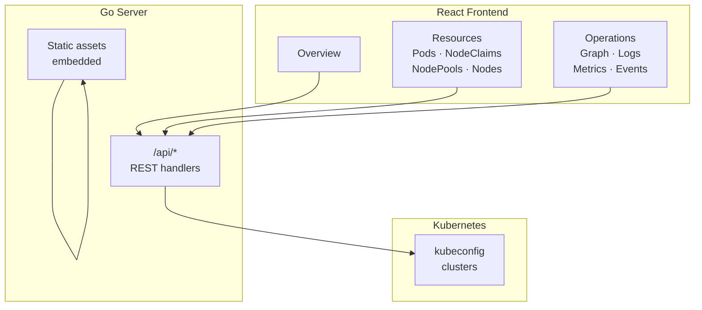

# CloudBurst UI

Dashboard for [CloudBurst Autoscaler](https://github.com/braghettos/cloudburst-autoscaler). Connects to your cluster via **kubeconfig**—no port-forward required.

## Architecture



## Features

- **Fleet overview** — Multi-cluster view when multiple contexts exist in kubeconfig
- **Cluster overview** — Stats, health banner, key metrics (pods, NodeClaims, nodes), workloads (pending, running, unschedulable)
- **Resources** — Pods, NodeClaims, NodePools, Nodes with list and detail views
- **Operations** — Graph (resource relationships), Logs (controller), Metrics (Prometheus), Events
- **Filters** — Namespace, phase, type, search across list pages
- **Sorting and pagination** — DataTable with sortable columns and page size options
- **Dark mode** — Theme toggle
- **Auto-refresh** — Configurable polling for dashboard and metrics

## Tech Stack

| Layer | Technology |
|-------|-----------|
| Frontend | React, Vite, Tailwind CSS, TanStack Query |
| Backend | Go (net/http), embeds built assets |
| Cluster access | kubeconfig (in-cluster or local) |
| Kubernetes client | controller-runtime, client-go |

## Prerequisites

- Node.js 20+
- Go 1.24+
- [cloudburst-autoscaler](https://github.com/braghettos/cloudburst-autoscaler) at `../cloudburst-autoscaler` (for API types)

## Quick Start

```bash
make build
make run
# Open http://localhost:8082
```

## Development

```bash
# Terminal 1: run Go server (serves API + built assets)
make run

# Terminal 2: Vite dev server with HMR (proxies /api to 8082)
make dev
# Open http://localhost:5173
```

## Project Structure

```
web/                    # React app (Vite)

cmd/cloudburst-ui/      # Go server entry point
  main.go
  web/                  # Embedded built assets (generated)

internal/
  ui/                   # HTTP handlers, server
  cluster/              # Kubeconfig registry

config/ui/              # Kubernetes deployment manifests
```

## Configuration

### Environment Variables

| Variable | Required | Description |
|----------|----------|-------------|
| `KUBECONFIG` | No | Path to kubeconfig (default: `~/.kube/config`) |
| `PORT` | No | Server port (default: 8082). Use `--addr` flag to override. |

### Server Flags

- `--addr=:8082` — Address to bind the UI server
- `--web-dir=<path>` — Directory for static files (overrides embedded assets when set)

## Deployment

### Local

From this repo:

```bash
make run
```

Or from the cloudburst-autoscaler repo:

```bash
make run-ui
# Open http://localhost:8082
```

### In-cluster

Deployment manifests are in [config/ui/](config/ui/). Requires cloudburst-autoscaler as a sibling directory. Build and deploy:

```bash
make docker-build
make deploy
```

For Kind clusters, load the image first:

```bash
# From cloudburst-autoscaler repo
make deploy-ui
# Loads image into Kind and deploys
```

### Docker

From this repo:

```bash
make docker-build
```

Or manually from the parent of both repos:

```bash
cd $(dirname $(pwd))
docker build -f cloudburst-autoscaler-ui/Dockerfile -t cloudburst-autoscaler-ui .
```

The Dockerfile expects the cloudburst-autoscaler module at `../cloudburst-autoscaler` for API types.

## CI

GitHub Actions CI clones `cloudburst-autoscaler` as a sibling for the Go build. **For private repos**, `GITHUB_TOKEN` cannot access other private repositories—you must add a Personal Access Token:

1. **Create a PAT** — GitHub → Settings → Developer settings → Personal access tokens → Fine-grained (or classic) with `Contents: Read-only` for both `cloudburst-autoscaler-ui` and `cloudburst-autoscaler`.
2. **Add secret** — In the UI repo: Settings → Secrets and variables → Actions → New repository secret → `REPO_ACCESS_TOKEN` = your PAT.
3. **Optional variable** — If the autoscaler is in a different org, add variable `AUTOSCALER_REPO` = `owner/cloudburst-autoscaler`.

## Documentation

- [Cloudburst Autoscaler](https://github.com/braghettos/cloudburst-autoscaler) — Controller and CRD documentation
- [CloudBroker](https://github.com/braghettos/cloudbroker) — Pricing backend

## License

See [LICENSE](LICENSE).
